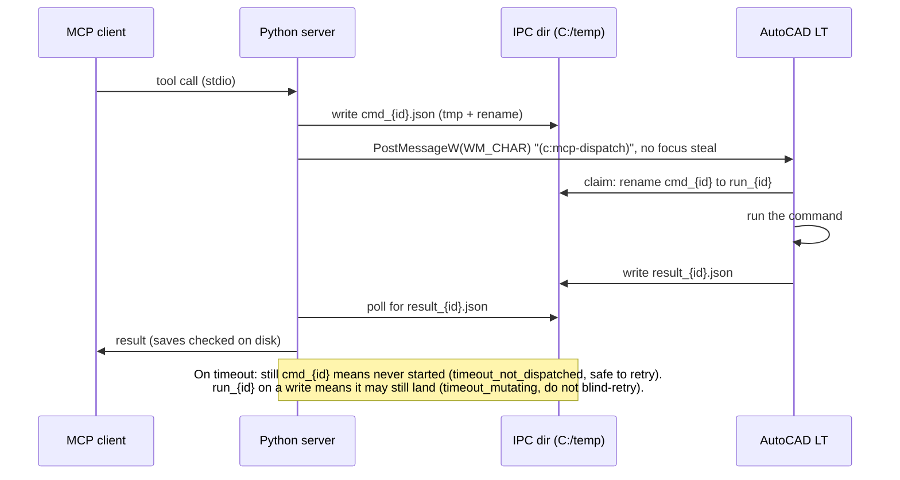

# AutoCAD MCP Server for AutoCAD LT

[](https://github.com/WiddlyBits/autocad-mcp/actions/workflows/ci.yml)

Connects an AI assistant to AutoCAD LT, so it can read, edit and check real drawings while you keep working. It's built and tested on AutoCAD LT 2027, and full AutoCAD is untested. It was developed with Claude and started as a fork of [puran-water/autocad-mcp](https://github.com/puran-water/autocad-mcp).

Upstream has accepted part of this work. On 2026-11-03, `hvkshetry` merged [#18](https://github.com/puran-water/autocad-mcp/pull/18) (a runnable test suite, ruff and CI) and [#19](https://github.com/puran-water/autocad-mcp/pull/19) (linear dimension orientation) into `puran-water/autocad-mcp` (633 stars, 122 forks, checked 2026-11-05).

> **New to this?** AutoCAD LT is drafting software used for technical drawings. MCP is the standard
> way to plug a tool into an AI assistant. This repo is that plug.

## Why it matters

An assistant is only useful in CAD if it can see what you see at a cost you can afford. These three features close that gap. Upstream has none of them as of `5a7ced7`, by reading its code, not running it.

**Select objects, and the assistant sees them.** You select by hand and ask. There's no `HS` to type and nothing to re-select. All 6 test selections read back exactly, covering 7 entity types in Model and on a layout, across 2 AutoCAD sessions. On a real drawing it read a 29,717-object selection in 454 ms, and the count matched the Properties palette. Stale-file recovery clears the grips, so `HS` stays as the fallback.

**The assistant reads the command line itself.** Nobody has to paste prompts or history, even while a command is waiting for input. With LINE waiting on a real drawing, the read cost about 200 tokens, estimated from its size. That's one command on a real drawing, and option keywords can come back as a count, without their names.

**Grid screenshots.** A labelled low-res preview tells the assistant where to crop, and the crop stays sharp. On one view of one drawing (window 3618x3218):

| | Full window | Grid preview + 4 crops |
|---|---|---|
| Tokens | 1,886 | 520 |
| Target labels read correctly | 2 of 5 | 5 of 5 |

The 5 labels were picked because the full window left them uncertain, so this is a worst case for the full window and says nothing about average accuracy. Those crops were small, about 40 tokens each. At a 270-token crop, the grid route costs more than a full window from the sixth crop on. A full window also answers layout questions that a crop can't.

## How it compares with upstream

Upstream became active again in November 2026, so this comparison is dated. It was made by reading upstream's code at `5a7ced7` and hasn't been run against it. Upstream now has journaled native revision batches and Windows dialog recovery (`system(revision)`, `system(desktop)`), and this fork has neither. If you need those, use upstream.

| Area | Upstream at `5a7ced7` | This fork |
|---|---|---|
| Plain saves and DXF export | `drawing(save)` reports success without checking (its `revision` save does check). A failed save once said "saved" on a real drawing | Checks the file on disk and reports failure if it isn't there |
| Screenshots | Always full size. In one real session, 41 of them came to about 196,000 tokens at 1440p | Capped at 1280 px (about 49,000 tokens for the same 41), with crops, and saving to disk costs 0 until read |
| Reading a drawing | Entity `get` adds geometry for LINE and CIRCLE only. `revision read` returns native entity data | Full geometry and extents from both backends, plus probes: ask "does this overlap?" or "what does this label say?" and get an exact answer with no screenshot |
| Timeouts | Keeps a pending receipt and refuses more work until it's reconciled | Says whether the action never started (safe to retry) or may still finish (don't repeat it) |
| Busy AutoCAD or wrong drawing | `revision` batches check both. Plain tools don't | Refuses inside an active command, and `assert_doc` and the skill's guard refuse the wrong drawing |
| Switching drawings | Not available | `system(switch_doc)` switches with no click and confirms through `DWGNAME` |
| Erasing | Erasing something already erased brings it back | Reports "not found" |
| Opening a drawing | Reports success without checking | Says it can't, and names the drawing that is still active |
| Safety labels | Marks `system`, which can run any code, as read-only | Each tool labelled correctly, so the assistant knows which actions need your OK |
| Tests | 226 (CI at `53275a3`) | 879 |

This fork also ships working rules that teach an assistant to drive AutoCAD safely ([`skills/`](skills/)).
Known limits are listed in [docs/known-issues.md](docs/known-issues.md). Error codes and when a retry
is safe: [docs/error-model.md](docs/error-model.md).

## Problems found in daily use

These came up in real drafting work.

| Problem | What happens now |
|---|---|
| **PDF plotting did nothing.** The plot command was fed its answers in the wrong order, so the file path landed on the wrong question and no PDF appeared. | `drawing(plot_pdf)` sends AutoCAD LT 2027's real 18-step plot sequence, captured from a manual run, and the save-verification skill has the assistant confirm the PDF landed. With drawing switching, the assistant can plot one open drawing after another. Currently set up for ARCH D landscape sheets. Upstream's `drawing(plot_pdf)` is unchanged; its newer `revision` plot hasn't been tested here. |
| **Selections took four round trips to describe.** In the sessions that prompted selection handoff, 129 of 193 tool calls went on this kind of back-and-forth. | One call reports what's selected and edits exactly those objects. |
| **"Saved" didn't mean saved.** A failed save reported success, and the drawing that was still open was the original. | Every save and DXF export is checked on disk. If the file isn't there, you're told. |
| **The server hung when AutoCAD was closed.** One `system(status)` call ran 1,046 s with no answer, a deadlock while loading numpy on the fallback path. | The same call answers in under a second, measured through a chat's MCP connection. |

## Contributing back upstream

`hvkshetry` merged [#18](https://github.com/puran-water/autocad-mcp/pull/18) and [#19](https://github.com/puran-water/autocad-mcp/pull/19) on 2026-11-03. Another contributor's [#15](https://github.com/puran-water/autocad-mcp/pull/15), merged the same day, fixed the duplicated tool results that this fork had also fixed.

The rest of the work is ready as a stack of small pull requests against this fork, each with its own tests and CI run, and hasn't been offered upstream: [#3](https://github.com/WiddlyBits/autocad-mcp/pull/3) to [#10](https://github.com/WiddlyBits/autocad-mcp/pull/10) cover results sent once, screenshot cost controls, tool annotations, entity geometry, probes, IPC timeouts and verified saves, command claims and `assert_doc`, and the error model docs.

Still fork-only: selection handoff, `system(command_line)`, `switch_doc`, grid and `region_dwg` screenshots, probes, verified saves, the LT 2027 `drawing(plot_pdf)` sequence and the assistant skills.

## Technical overview

Two backends, one API:

| Backend | Runtime | Requires AutoCAD? | Screenshot |
|---------|---------|-------------------|------------|
| **File IPC** | Windows Python | Yes — AutoCAD LT 2024+ (Windows) | Win32 PrintWindow |
| **ezdxf** | Any platform | No (headless) | matplotlib render |

The server exposes **8 consolidated tools** (`drawing`, `entity`, `layer`, `block`, `annotation`, `pid`, `view`, `system`) over the MCP stdio transport. An MCP client (Claude Desktop, Claude Code, etc.) connects and drives AutoCAD through natural-language requests.

## Prerequisites (File IPC backend)

- **Windows 10/11** (the File IPC backend uses Win32 APIs for focus-free window messaging)
- **AutoCAD LT 2024 or newer** — AutoLISP support was added in LT 2024 for Windows. AutoCAD LT for Mac exists but does **not** support AutoLISP.
- Only LT 2027 has been tested. LT 2024 to 2026 should work by the feature list but haven't been run.
- **Python 3.10+** (Windows native — not WSL Python)
- **uv** package manager ([install guide](https://docs.astral.sh/uv/getting-started/installation/))

> The ezdxf headless backend works on any platform (Linux, macOS, WSL) for offline DXF generation without AutoCAD installed.

## Quick Start

### 1. Clone and install

```powershell
git clone https://github.com/WiddlyBits/autocad-mcp.git
cd autocad-mcp
uv sync
```

### 2. Load the LISP dispatcher in AutoCAD LT

Open AutoCAD LT and load `mcp_dispatch.lsp` using **APPLOAD**:

1. Type `APPLOAD` in the AutoCAD command line
2. Browse to `<repo>/lisp-code/mcp_dispatch.lsp`
3. Click **Load**
4. You should see: `=== MCP Dispatch v3.1 loaded ===` and `Ready for commands via (c:mcp-dispatch)`

> **Tip:** Add the file to your AutoCAD Startup Suite (in the APPLOAD dialog) so it loads automatically with every drawing.

### 3. Connect your assistant

Replace `C:\path\to\autocad-mcp` with your clone's path. `python.exe` must be the **Windows Python** inside the project venv, not WSL Python. `AUTOCAD_MCP_BACKEND` can be `auto` (default: tries File IPC, falls back to ezdxf), `file_ipc` (requires AutoCAD) or `ezdxf` (headless only).

**Claude** is what this server was developed and tested with. For Claude Code:

```powershell
claude mcp add autocad-mcp -s user -e AUTOCAD_MCP_BACKEND=auto -- C:\path\to\autocad-mcp\.venv\Scripts\python.exe -m autocad_mcp
```

If PowerShell mis-parses the arguments after `--`, call `claude.exe` by its full path. For Claude Desktop, add this to `claude_desktop_config.json`:

```json
{
  "mcpServers": {
    "autocad-mcp": {
      "command": "C:\\path\\to\\autocad-mcp\\.venv\\Scripts\\python.exe",
      "args": ["-m", "autocad_mcp"],
      "env": { "AUTOCAD_MCP_BACKEND": "auto" }
    }
  }
}
```

To add the working rules, run `powershell -ExecutionPolicy Bypass -File scripts\sync-skills.ps1 -Package` from the repo root and upload the 2 zips from `dist\` in claude.ai under Customize, then Skills. Without `-ExecutionPolicy Bypass`, a machine on Windows' default script policy refuses the script.

If Claude Code runs in WSL, launch the server through `cmd.exe` so it runs as a native Windows process:

```json
{
  "mcpServers": {
    "autocad-mcp": {
      "type": "stdio",
      "command": "cmd.exe",
      "args": ["/d", "/s", "/c", "cd /d C:\\path\\to\\autocad-mcp && .venv\\Scripts\\python.exe -m autocad_mcp"],
      "env": { "AUTOCAD_MCP_BACKEND": "auto" }
    }
  }
}
```

**Gemini CLI: not yet tested against this server.** The steps below follow [its MCP docs](https://github.com/google-gemini/gemini-cli/blob/main/docs/tools/mcp-server.md), read 2026-11-05. Add this to `%USERPROFILE%\.gemini\settings.json`:

```json
{
  "mcpServers": {
    "autocad-mcp": {
      "command": "C:\\path\\to\\autocad-mcp\\.venv\\Scripts\\python.exe",
      "args": ["-m", "autocad_mcp"],
      "env": { "AUTOCAD_MCP_BACKEND": "auto" }
    }
  }
}
```

**OpenAI Codex CLI: not yet tested against this server.** The steps below follow [its MCP docs](https://developers.openai.com/codex/mcp), read 2026-11-05. Either run:

```powershell
codex mcp add autocad-mcp --env AUTOCAD_MCP_BACKEND=auto -- C:\path\to\autocad-mcp\.venv\Scripts\python.exe -m autocad_mcp
```

or add this to `%USERPROFILE%\.codex\config.toml`:

```toml
[mcp_servers.autocad-mcp]
command = 'C:\path\to\autocad-mcp\.venv\Scripts\python.exe'
args = ["-m", "autocad_mcp"]

[mcp_servers.autocad-mcp.env]
AUTOCAD_MCP_BACKEND = "auto"
```

**Skills outside Claude are untested too.** Gemini CLI and Codex both document Agent Skills, folders holding a `SKILL.md`: Gemini reads `%USERPROFILE%\.gemini\skills\` or `%USERPROFILE%\.agents\skills\`, and Codex reads `%USERPROFILE%\.agents\skills\`. The skills here were written for Claude and name its tools as `mcp__autocad-mcp__*`, so expect to adjust them. If your client shows only tool descriptions, those state the same first step: run `init`.

The Gemini web app and ChatGPT aren't covered by any of this.

### 4. Verify

With AutoCAD LT open and a drawing in front, ask your assistant to call:

```
system(operation="init")
```

You should see `backend: "file_ipc"` and `select: true` in the `preflight` block. `backend: "ezdxf"` with AutoCAD open means it isn't connected to your drawing, so stop and check step 2. `system(operation="status")` repeats the check later without reloading anything.

## Tools

### `drawing` — File/drawing management

| Operation | Description | File IPC | ezdxf |
|-----------|-------------|----------|-------|
| `create` | Reset to clean drawing (erase all + purge). On AutoCAD it refuses and changes nothing | No | Yes |
| `open` | Open an existing drawing | No — see below | Yes (DXF) |
| `info` | Get entity count and layers | Yes | Yes |
| `save` | Save current drawing (to path if given) | Yes | Yes |
| `save_as_dxf` | Export as DXF | Yes | Yes |
| `plot_pdf` | Plot to PDF | Yes | No |
| `purge` | Purge unused objects | Yes | Yes |
| `get_variables` | Get system variables by name | Yes | Yes |
| `undo` | Undo last operation | Yes | No |
| `redo` | Redo last undone operation | Yes | No |

### `entity` — Entity CRUD + modification

**Create:** `create_line`, `create_circle`, `create_polyline`, `create_rectangle`, `create_arc`, `create_ellipse`, `create_mtext`, `create_hatch`

**Read:** `list`, `count`, `get`

**Modify:** `copy`, `move`, `rotate`, `scale`, `mirror`, `offset`\*, `array`, `fillet`\*, `chamfer`\*, `erase`

> \* `offset`, `fillet`, `chamfer` are File IPC only (not supported in ezdxf headless backend).

### `layer` — Layer management

`list`, `create`, `set_current`, `set_properties`, `freeze`, `thaw`, `lock`, `unlock`

### `block` — Block operations

| Operation | File IPC | ezdxf |
|-----------|----------|-------|
| `list` | Yes | Yes |
| `insert` | Yes | Yes |
| `insert_with_attributes` | Yes | Yes |
| `get_attributes` | Yes | Yes |
| `update_attribute` | Yes | Yes |
| `define` | No | Yes |

### `annotation` — Text, dimensions, leaders

`create_text`, `create_dimension_linear`, `create_dimension_aligned`, `create_dimension_angular`, `create_dimension_radius`, `create_leader`

### `pid` — P&ID operations (CTO symbol library)

`setup_layers`, `insert_symbol`, `list_symbols`, `draw_process_line`, `connect_equipment`, `add_flow_arrow`, `add_equipment_tag`, `add_line_number`, `insert_valve`, `insert_instrument`, `insert_pump`, `insert_tank`

> P&ID symbol insertion requires the [CAD Tools Online](https://www.cadtoolsonline.com/) (CTO) P&ID Symbol Library installed at `C:\PIDv4-CTO\`. The ezdxf backend has built-in CTO library support. For the File IPC backend, some P&ID operations require additional LISP helpers — see the P&ID section in the wiki for setup details.

### `view` — Viewport and screenshot

| Operation | Description |
|-----------|-------------|
| `zoom_extents` | Zoom to show all entities |
| `zoom_window` | Zoom to a specified window |
| `get_screenshot` | Capture current AutoCAD view as an image |

Screenshots use `PrintWindow` (Win32) for the File IPC backend — works even when AutoCAD is minimized or in the background. The ezdxf backend renders via matplotlib.

`get_screenshot` accepts these cost parameters, since screenshots dominate token usage in long automation sessions:

| Parameter | Default | Description |
|-----------|---------|-------------|
| `region` | `null` | `[left, top, right, bottom]` pixel rect of the captured window, cropped **before** downscaling so the crop keeps full source resolution. Clamped to the image; a region that is empty or entirely outside it is an error rather than a silent full-frame capture. Also takes `"canvas"` (drop the ribbon and palettes) or `"changed"` (only what changed since the last capture). |
| `grid` | `false` | Low-res preview with rules labelled in native window pixels, so a label can go straight back as `region`. Ignores `max_dimension`. |
| `region_dwg` | `null` | `[x1, y1, x2, y2]` in drawing coordinates, for example a `sel-dump` bbox. Refused where the mapping can't hold, such as tiled viewports. |
| `save_to` | `null` | Write the PNG to this path and return only its path and cost, with **no image attached**. |
| `max_dimension` | `1280` | Cap on the longest side in pixels (clamped to 64–2576, as an argument and not only as an env default). Pass `null` for full resolution; non-positive values are treated as full resolution. Never upscales. |
| `quality` | `null` | If set (clamped to 1–95), encodes JPEG instead of PNG. Shrinks the transferred payload; does **not** reduce token cost. |

Every successful capture reports `width`, `height`, and `est_tokens` — what looking at it costs.

**How cost is counted.** Vision models bill an image as `ceil(width/28) * ceil(height/28)` tokens: pixel dimensions only, not file size or format. A 2560×1440 window costs 4,784 uncapped and 1,196 at the 1280 default. A 500×400 `region` crop costs 270 and stays sharp, because cropping happens before the downscale. `save_to` costs nothing until the file is read.

Two consequences worth knowing:

- **`quality` is not a cost lever.** JPEG shrinks bytes on the wire, not tokens. Its compression artifacts on thin linework and small text buy nothing in usage terms, so reach for it only when transfer or storage size actually matters.
- **Downscaling can make the PNG bigger.** Resampling turns crisp 1px linework into antialiased gradients that deflate compresses poorly — a 1928×1218 AutoCAD capture measured 124 KB uncapped and 253 KB at 1280. The token cost still falls by more than half, so the default is right; just don't expect the file to shrink.

The upper clamp is 2576 because the vision API downscales anything longer before the model sees it (and caps one image at 4,784 visual tokens), so larger captures are transmitted and then discarded. The global default is set by `AUTOCAD_MCP_SCREENSHOT_MAX_DIM`; the other tools' `include_screenshot` option always uses that default.

### `system` — Server management

`status`, `health`, `get_backend`, `runtime`, `init`, `execute_lisp`, `command_line`, `switch_doc`, `assert_doc`

> `switch_doc` makes another open drawing active with no click or keystroke (`data: {dwg: "B.dwg"}`), and is `ok` only when AutoCAD's `DWGNAME` confirms it. How it was found: [docs/investigations/2026-10-16-document-switching.md](docs/investigations/2026-10-16-document-switching.md).

> `execute_lisp` runs arbitrary AutoLISP code (File IPC only). Pass `data: {code: "(+ 1 2)"}`. This turns the server into an extensible automation platform — any valid AutoLISP expression can be executed.

## Architecture

```
MCP Client (Claude)
    │  stdio (JSON-RPC)
    ▼
Python MCP Server (autocad_mcp)
    │
    ├── File IPC Backend ──► C:/temp/*.json ──► mcp_dispatch.lsp (AutoCAD LT)
    │   PostMessageW(WM_CHAR) to MDIClient — no focus steal
    │
    └── ezdxf Backend ──► in-memory DXF (headless, no AutoCAD needed)
```

The File IPC backend sends keystrokes to AutoCAD's MDIClient window via `PostMessageW(WM_CHAR)`, triggering the `(c:mcp-dispatch)` AutoLISP command. This approach does **not** steal window focus — you can continue working in other applications while automation runs.

One File IPC round trip, including how a timeout is classified:



## Environment Variables

| Variable | Default | Description |
|----------|---------|-------------|
| `AUTOCAD_MCP_BACKEND` | `auto` | Backend selection: `auto`, `file_ipc`, `ezdxf` |
| `AUTOCAD_MCP_IPC_DIR` | `C:/temp` | Directory for IPC command/result JSON files (must match on both Python and LISP sides) |
| `AUTOCAD_MCP_IPC_TIMEOUT` | `10.0` | IPC command timeout in seconds (1-300) |
| `AUTOCAD_MCP_ONLY_TEXT` | `false` | Suppress all returned images — both the `include_screenshot` option and `view(get_screenshot)`. The capture still runs and still reports `width`/`height`/`est_tokens`, so you can see what a run *would* have spent without spending it; `save_to` still writes to disk, since that costs no context. |
| `AUTOCAD_MCP_SCREENSHOT_MAX_DIM` | `1280` | Default cap on a screenshot's longest side in pixels (64–2576). Invalid values fall back to the default. |

> **Note:** If you change `AUTOCAD_MCP_IPC_DIR`, you must also update the `*mcp-ipc-dir*` variable in `mcp_dispatch.lsp` to match.

## Development

```powershell
uv sync
uv run pytest tests/ -v
```

## AutoCAD LT AutoLISP Compatibility

AutoLISP was added to AutoCAD LT in the **2024 release (Windows only)**. AutoCAD LT for Mac does not support AutoLISP.

| Supported (LT 2024+ Windows) | Not Supported |
|-------------------------------|---------------|
| `.lsp` / `.fas` / `.vlx` / `.dcl` | VLIDE (Visual LISP IDE) |
| All `vl-*` utility functions, and `vlax-get-acad-object` (LT 2027, measured 2026-10-08) | Full `vlax-*` (ActiveX/COM) is not documented for LT |
| File I/O (`open`, `read-line`, etc.) | Express Tools |
| Entity access (`entget`, `entmod`, etc.) | 3D operations |
| Selection sets | AutoLISP on Mac |

The `mcp_dispatch.lsp` dispatcher is fully compatible with LT 2024+.

## Notable engineering

- **[Switching drawings without a click](docs/investigations/2026-10-16-document-switching.md)** (2026-10-16). LT has no COM, refuses OPEN from LISP, and `vla-Activate` reports a switch that never happens. Synthetic Ctrl+Tab was disproved; `GetGUIThreadInfo` showed the Start tab's embedded Chromium widget holding keyboard focus. Fix: `WM_MDIACTIVATE` on the frame's `MDIClient`, confirmed by `DWGNAME`. Also closed a silent fall-through to the headless backend while Start was in front.

## License

MIT
