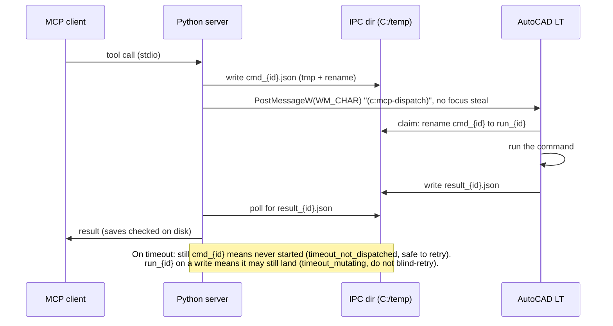

# autocad-lt-mcp

[](https://github.com/WiddlyBits/autocad-lt-mcp/actions/workflows/ci.yml)

An MCP server for AutoCAD LT. It connects an AI assistant to AutoCAD LT, so it can read, edit and check real drawings while you keep working. It's built and tested on AutoCAD LT 2027, and full AutoCAD is untested. It was developed with Claude and started as a fork of [puran-water/autocad-mcp](https://github.com/puran-water/autocad-mcp).

Not affiliated with, endorsed by or sponsored by Autodesk, Inc. AutoCAD and AutoCAD LT are registered trademarks of Autodesk, Inc.

> **New to this?** AutoCAD LT is drafting software used for technical drawings. MCP is the standard
> way to plug a tool into an AI assistant. This repo is that plug.

## Measured against upstream

Measured 2026-11-07 on live AutoCAD LT 2027: same drawing, same window, same model (Opus 5.5), one headless `claude -p` session per run, counted with [`tests/token_audit.py`](tests/token_audit.py). Upstream is `puran-water/autocad-mcp` at `5a7ced7`; this repo was at `9e99e8f`.

**Screenshots: read 6 title-block values off a whole-sheet layout view**

| Route | Runs | Image | Image tokens | Values read |
|---|---|---|---|---|
| Upstream `get_screenshot` (its only option) | 2 | 2044×1818 | 4,745 | **0 of 6** in both runs: the title block was outside the captured area |
| This repo, full window (1280 px cap) | 2 | 1280×1138 | 1,886 | 5 of 6 in both runs (the title was too small to read) |
| This repo, `grid=true` preview + 1 crop | 2 | 560×498 + one ~650×290 crop | 600 / 635 | **6 of 6** in both runs |

On this display, upstream's capture held only the top-left 80% × 80% of the AutoCAD window (pixel correlation r = 0.999 against this repo's full-window capture of the same view). The right and bottom 20% never reached the model, and that is where a title block sits. Upstream spent 2.5× the tokens of this repo's full window and 7.5× the grid route's, and read none of the 6 values. AutoCAD was on a secondary 2880×2560 monitor with the primary at 120 DPI. The crop is very likely a DPI-scaling bug in upstream's capture, but the cause wasn't isolated, and on a single 100%-scaled monitor upstream may capture the whole window.

**Selection: "tell me exactly what I have selected"** (23 objects on layer TITLE in Layout1: 14 MTEXT, 8 LINE, 1 LWPOLYLINE)

| Route | Runs | Exact (count, types and text) | What comes back |
|---|---|---|---|
| Upstream: the assistant writes its own `(ssgetfirst)` LISP | 3 | 2 of 3 (one run reported 13 MTEXT and 9 LINE) | Whatever the assistant thought to ask for |
| This repo: skill + `(mcp:sel-dump)` | 3 | **3 of 3** | Every entity's type, layer, text and geometry, the union bounding box, and where the selection came from (`source: "implied"`) |

Selection here is more accurate and more complete, not cheaper. Upstream's runs used 3 to 4 requests and 1.0 to 2.1 KB of result; this repo's used 5 requests and 7.4 KB, part of that a heavier baseline (longer tool descriptions plus the skill). Upstream no longer sends ESC before a command, so live grips survive there too, and an assistant that knows AutoLISP can read them in one call. What this repo adds is the same complete answer every time without that knowledge, plus the `HS` stash for when the grips are gone (an ESC or a command consumed them). Upstream can't recover that case, and this test didn't exercise it.

Caveats: 2 to 3 runs per arm, one drawing, one window, one display setup.

## What else it does

**Select objects, and the assistant sees them.** You select by hand and ask. There's no `HS` to type and nothing to re-select. All 6 earlier test selections read back exactly, covering 7 entity types in Model and on a layout, across 2 AutoCAD sessions. On a real drawing it read a 29,717-object selection in 454 ms, and the count matched the Properties palette.

**The assistant reads the command line itself.** Nobody has to paste prompts or history, even while a command is waiting for input. With LINE waiting on a real drawing, the read cost about 200 tokens, estimated from its size, n = 1. Option keywords can come back as a count, without their names. When a call times out, the error carries the prompt AutoCAD is waiting on, so a hung command explains itself.

**Grid screenshots, beyond the benchmark.** On a second drawing (window 3618×3218), a grid preview plus 4 small crops cost 520 tokens and read 5 of 5 target labels, against 1,886 tokens and 2 of 5 for the full window. The 5 labels were picked because the full window left them uncertain, so that is a worst case for the full window. At a 270-token crop, the grid route costs more than a full window from the sixth crop on, and a full window still answers layout questions a crop can't.

## Other differences from upstream

Read from upstream's code at `5a7ced7`, not run against it. Upstream became active again in November 2026 and has journaled native revision batches and Windows dialog recovery (`system(revision)`, `system(desktop)`), which this repo lacks. If you need those, use upstream.

| Area | Upstream at `5a7ced7` | This repo |
|---|---|---|
| Plain saves and DXF export | `drawing(save)` reports success without checking (its `revision` save does check). A failed save once said "saved" on a real drawing | Checks the file on disk and reports failure if it isn't there |
| Screenshots | Always full size. In one real session, 41 of them came to about 196,000 tokens at 1440p | Capped at 1280 px (about 49,000 tokens for the same 41), with crops, and saving to disk costs 0 until read |
| Reading a drawing | Entity `get` adds geometry for LINE and CIRCLE only. `revision read` returns native entity data | Full geometry and extents from both backends, plus probes: ask "does this overlap?" or "what does this label say?" and get an exact answer with no screenshot |
| Timeouts | Keeps a pending receipt and refuses more work until it's reconciled | Says whether the action never started (safe to retry) or may still finish (don't repeat it), and attaches the prompt AutoCAD is waiting on |
| Busy AutoCAD or wrong drawing | `revision` batches check both. Plain tools don't | Refuses inside an active command, and `assert_doc` and the skill's guard refuse the wrong drawing |
| Switching drawings | Not available | `system(switch_doc)` switches with no click and confirms through `DWGNAME` |
| Erasing | Erasing something already erased brings it back | Reports "not found" |
| Opening a drawing | Reports success without checking | Says it can't, and names the drawing that is still active |
| Safety labels | Marks `system`, which can run any code, as read-only | Each tool labelled correctly, so the assistant knows which actions need your OK |
| Tests | 226 (CI at `53275a3`) | 898 |

This repo also ships working rules that teach an assistant to drive AutoCAD safely ([`skills/`](skills/)).
Known limits are listed in [docs/known-issues.md](docs/known-issues.md). Error codes and when a retry
is safe: [docs/error-model.md](docs/error-model.md).

## Problems found in daily use

These came up in real drafting work.

| Problem | What happens now |
|---|---|
| **PDF plotting did nothing.** The plot command was fed its answers in the wrong order, so the file path landed on the wrong question and no PDF appeared. | `drawing(plot_pdf)` sends AutoCAD LT 2027's real 18-step plot sequence, captured from a manual run, and the save-verification skill has the assistant confirm the PDF landed. With drawing switching, the assistant can plot one open drawing after another. Currently set up for ARCH D landscape sheets. Upstream's `drawing(plot_pdf)` is unchanged; its newer `revision` plot hasn't been tested here. |
| **Selections took four round trips to describe.** In the sessions that prompted selection handoff, 129 of 193 tool calls went on this kind of back-and-forth. | One call reports what's selected and edits exactly those objects. |
| **"Saved" didn't mean saved.** A failed save reported success, and the drawing that was still open was the original. | Every save and DXF export is checked on disk. If the file isn't there, you're told. |
| **The server hung when AutoCAD was closed.** One `system(status)` call ran 1,046 s with no answer, a deadlock while loading numpy on the fallback path. | The same call answers in under a second, measured through a chat's MCP connection. |

## Where the recent fixes are tested

Each row names a test that fails if the fix is undone. All three files pass on `main` (31 and 9 tests, run 2026-11-12).

| Fix | What you see now | Test |
|---|---|---|
| A tool call with an argument in the wrong place | The error names the missing argument and where it belongs, instead of succeeding silently or showing a bare `KeyError` | [`test_data_key_at_top_level_names_the_missing_argument`](tests/test_misplaced_args.py) |
| A timeout while AutoCAD waits for input | The error carries the prompt AutoCAD is waiting on, and says whether the action may still finish | [`TestPendingPrompt`](tests/test_dispatch_claim.py) |
| AutoCAD closed mid-session | `system(init)` refuses rather than quietly switching to the headless backend, and `system(status)` reports a dead window instead of "idle" | [`test_init_refuses_instead_of_landing_on_ezdxf`](tests/test_autocad_gone.py), [`test_dead_window_is_not_idle_or_fresh`](tests/test_autocad_gone.py) |

## A test gate for AI-written changes

When an AI assistant edits this repo, "all done" can be wrong: a test quietly deleted, a skip added, or the expected test count lowered to match. This repo has a gate that catches those, and it works as a gate. At the end of each turn it runs a checker, and if a check fails it hands the failure back so the assistant has to fix it before it can finish. The gate is opt-in and per checkout: it only runs while a `.claude/gate.on` file exists and a Stop hook is registered in your local Claude Code settings. It does nothing for people who just use the server.

| Check | What it catches | Proof |
|---|---|---|
| Tests pass, and the count doesn't drop below the number in `CLAUDE.md` | Failing or deleted tests | Planted a deleted test: caught (888 passed against a baseline of 889 at the time) |
| `CLAUDE.md` count unchanged against the starting commit | Lowering the bar to pass | Planted 889 to 888 alongside a deleted test: caught |
| No new `skip` or `xfail`; assert count doesn't fall | Silenced or gutted tests | Planted a skip: caught |
| `ruff` lint | What CI would reject | Planted an unused import: caught |
| Every version string matches `pyproject.toml` (6 places) | Version drift, which no test covered | Planted a stale string: caught. Three had already drifted and are fixed |
| No change under `tests/golden/` | A red snapshot rebaselined into a pass | Part of the check list; not planted |

One gap it found in itself: the screenshot size limit (64 to 2576 px) was only tested against its own constant, so changing the number passed. [`test_max_dimension_range_is_pinned`](tests/test_screenshot.py) now pins it, and the plant fails.

Known limits: it can't see a test rewritten to `assert True` (it prints a "tests modified" warning for a human to review), and it only text-checks the AutoLISP, since LISP can't run offline. The gate has been tested with Claude only; Google and OpenAI assistants are untested. The checker is [`scripts/check.py`](scripts/check.py) and the hook is [`scripts/stop_gate.py`](scripts/stop_gate.py). Its `--selftest` flag checks the parsers; the plant results above were run by hand, not by CI.

## Contributing back upstream

`hvkshetry` merged [#18](https://github.com/puran-water/autocad-mcp/pull/18) and [#19](https://github.com/puran-water/autocad-mcp/pull/19) on 2026-11-03. Another contributor's [#15](https://github.com/puran-water/autocad-mcp/pull/15), merged the same day, fixed the duplicated tool results that this fork had also fixed.

The rest of the work is ready as a stack of small pull requests against this fork, each with its own tests and CI run, and hasn't been offered upstream: [#3](https://github.com/WiddlyBits/autocad-lt-mcp/pull/3) to [#10](https://github.com/WiddlyBits/autocad-lt-mcp/pull/10) cover results sent once, screenshot cost controls, tool annotations, entity geometry, probes, IPC timeouts and verified saves, command claims and `assert_doc`, and the error model docs.

Still fork-only: selection handoff, `system(command_line)`, `switch_doc`, grid and `region_dwg` screenshots, probes, verified saves, the LT 2027 `drawing(plot_pdf)` sequence and the assistant skills.

## Technical overview

Two backends, one API:

| Backend | Runtime | Requires AutoCAD? | Screenshot |
|---------|---------|-------------------|------------|
| **File IPC** | Windows Python | Yes — AutoCAD LT 2024+ (Windows) | Win32 PrintWindow |
| **ezdxf** | Any platform | No (headless) | matplotlib render |

The server exposes **7 consolidated tools** (`drawing`, `entity`, `layer`, `block`, `annotation`, `view`, `system`) over the MCP stdio transport. An MCP client (Claude Desktop, Claude Code, etc.) connects and drives AutoCAD through natural-language requests.

## Upgrading from `autocad-mcp`

This fork was renamed from `autocad-mcp` to `autocad-lt-mcp` on 2026-11-07. An install set up before then needs these changes:

1. `git pull`, then `uv sync` in the clone. The Python module is now `autocad_lt_mcp`, so `-m autocad_mcp` stops working.
2. In your client config, change the args to `-m autocad_lt_mcp`. Renaming the server entry from `autocad-mcp` to `autocad-lt-mcp` is optional, but it changes the tool names to `mcp__autocad-lt-mcp__*`, so update any permission rules that name the old prefix. For Claude Code: `claude.cmd mcp remove autocad-mcp -s user`, then run the `mcp add` line in step 3 below.
3. Restart AutoCAD, or `APPLOAD` `lisp-code\mcp_dispatch.lsp` again. The IPC files in `C:\temp` are now named `autocad_lt_mcp_*`, so an AutoCAD that still has the old dispatcher loaded never sees a command, and every call times out.
4. The skills are now `autocad-lt-mcp-workflow` and `autocad-lt-save-verification`. Upload the new ones and delete the old two.

The `AUTOCAD_MCP_*` environment variables keep their names.

## Prerequisites (File IPC backend)

- **Windows 10/11** (the File IPC backend uses Win32 APIs for focus-free window messaging)
- **AutoCAD LT 2024 or newer** — AutoLISP support was added in LT 2024 for Windows. AutoCAD LT for Mac exists but does **not** support AutoLISP.
- Only LT 2027 has been tested. LT 2024 to 2026 should work by the feature list but haven't been run.
- **Python 3.10+** (Windows native — not WSL Python)
- **uv** package manager ([install guide](https://docs.astral.sh/uv/getting-started/installation/))
- **Git**, and an MCP client such as Claude Code (step 3)

> The ezdxf headless backend works on any platform (Linux, macOS, WSL) for offline DXF generation without AutoCAD installed.

## Quick Start

### 1. Clone and install

```powershell
git clone https://github.com/WiddlyBits/autocad-lt-mcp.git
cd autocad-lt-mcp
uv sync
```

### 2. Load the LISP dispatcher in AutoCAD LT

Open AutoCAD LT and load `mcp_dispatch.lsp` using **APPLOAD**:

1. Type `APPLOAD` in the AutoCAD command line
2. Browse to `<repo>/lisp-code/mcp_dispatch.lsp`
3. Click **Load**
4. You should see: `=== MCP Dispatch v3.1 loaded ===` and `Ready for commands via (c:mcp-dispatch)`

Then add it to the **Startup Suite** in the same dialog (Startup Suite, Contents, Add). **Load** only covers the current drawing, so without this every other drawing fails step 4 with `mcp_dispatch.lsp not loaded`.

> A default install has `SECURELOAD` 1, so AutoCAD may ask before loading a file from outside its trusted paths. Choose **Always Load**, or add `<repo>\lisp-code` under Options, Files, Trusted Locations. The test machine runs with `SECURELOAD` 0, so this prompt hasn't been observed with this repo.

### 3. Connect your assistant

Replace `C:\path\to\autocad-lt-mcp` with your clone's path. `python.exe` must be the **Windows Python** inside the project venv, not WSL Python. `AUTOCAD_MCP_BACKEND` can be `auto` (default: tries File IPC, falls back to ezdxf), `file_ipc` (requires AutoCAD) or `ezdxf` (headless only).

**Claude** is what this server was developed and tested with. For Claude Code:

```powershell
claude.cmd mcp add autocad-lt-mcp -s user -e AUTOCAD_MCP_BACKEND=auto -- C:\path\to\autocad-lt-mcp\.venv\Scripts\python.exe -m autocad_lt_mcp
```

Use `claude.cmd` if npm installed Claude Code: PowerShell drops the `--` on its way through npm's `claude.ps1`, and plain `claude` fails with `unknown option '-m'`. Check with `claude mcp list`, which should show `autocad-lt-mcp` as connected. A native install hasn't been tested. For Claude Desktop, open Settings, Developer, Edit Config, add this to `claude_desktop_config.json`, and restart the app:

```json
{
  "mcpServers": {
    "autocad-lt-mcp": {
      "command": "C:\\path\\to\\autocad-lt-mcp\\.venv\\Scripts\\python.exe",
      "args": ["-m", "autocad_lt_mcp"],
      "env": { "AUTOCAD_MCP_BACKEND": "auto" }
    }
  }
}
```

To add the working rules, run `powershell -ExecutionPolicy Bypass -File scripts\sync-skills.ps1 -Package` from the repo root and upload the 2 zips from `dist\` in claude.ai under Customize, then Skills. Without `-ExecutionPolicy Bypass`, a machine on Windows' default script policy refuses the script.

If Claude Code runs in WSL, launch the server through `cmd.exe` so it runs as a native Windows process:

```json
{
  "mcpServers": {
    "autocad-lt-mcp": {
      "type": "stdio",
      "command": "cmd.exe",
      "args": ["/d", "/s", "/c", "cd /d C:\\path\\to\\autocad-lt-mcp && .venv\\Scripts\\python.exe -m autocad_lt_mcp"],
      "env": { "AUTOCAD_MCP_BACKEND": "auto" }
    }
  }
}
```

Gemini and Codex were tested on 2026-11-07 against the ezdxf backend, with no AutoCAD running. Codex also drove a live AutoCAD LT 2027 on `auto`: it confirmed the drawing, then created, read back and erased a line, 9 of 9 calls on File IPC. Antigravity hasn't driven a live AutoCAD yet.

**Gemini: use Antigravity CLI.** Tested with Antigravity CLI 1.5.3, signed in with a personal Google account. Install it from [its getting-started page](https://antigravity.google/docs/getting-started?tab=cli), run `agy` once to sign in, and add this to `%USERPROFILE%\.gemini\config\mcp_config.json`:

```json
{
  "mcpServers": {
    "autocad-lt-mcp": {
      "command": "C:\\path\\to\\autocad-lt-mcp\\.venv\\Scripts\\python.exe",
      "args": ["-m", "autocad_lt_mcp"],
      "env": { "AUTOCAD_MCP_BACKEND": "auto" }
    }
  }
}
```

`agy mcp list` should show `autocad-lt-mcp` as `enabled`. Antigravity calls these tools through its own `call_mcp_tool` without showing the model their schemas first, so the model guesses where arguments go and retries from the error, which names the right place. A 9-step test drawing took 18 calls, 9 of them retries, and the saved file matched what was asked.

**Gemini CLI no longer works with a personal Google account.** Google [stopped serving it](https://developers.googleblog.com/an-important-update-transitioning-gemini-cli-to-antigravity-cli/) on June 18, 2026 for free, AI Pro and Ultra accounts. Gemini CLI 0.67.0 signs in, then refuses with `This client is no longer supported for Gemini Code Assist for individuals`. It still runs with a paid Gemini API key or a Code Assist Standard or Enterprise license. With the block above under `mcpServers` in `%USERPROFILE%\.gemini\settings.json`, `gemini mcp list` showed `autocad-lt-mcp` as Connected, but only after the folder Gemini runs in was trusted; before that it reported Disabled. No tool calls through Gemini CLI have been tested.

**OpenAI Codex CLI.** Tested with Codex CLI 0.167.0, signed in with ChatGPT: 10 of 10 calls succeeded on the first try, a screenshot included. Add this to `%USERPROFILE%\.codex\config.toml`. The [documented](https://developers.openai.com/codex/mcp) `codex mcp add autocad-lt-mcp --env AUTOCAD_MCP_BACKEND=auto -- C:\path\to\autocad-lt-mcp\.venv\Scripts\python.exe -m autocad_lt_mcp` should write the same entry, but wasn't the form tested.

```toml
[mcp_servers.autocad-lt-mcp]
command = 'C:\path\to\autocad-lt-mcp\.venv\Scripts\python.exe'
args = ["-m", "autocad_lt_mcp"]

[mcp_servers.autocad-lt-mcp.env]
AUTOCAD_MCP_BACKEND = "auto"
```

Codex asks before each call to this server, because its tools are marked as able to change the drawing. `codex exec` can't ask, so it refuses them with `MCP tool call requires approval, but approval policy is never`. To let this server's tools through there, add `default_tools_approval_mode = "approve"` under `[mcp_servers.autocad-lt-mcp]`. It was tested as `-c 'mcp_servers.autocad-lt-mcp.default_tools_approval_mode="approve"'`. Codex names the tools `mcp__autocad_lt_mcp__system` and so on.

**Skills outside Claude.** Copy `skills\autocad-lt-mcp-workflow` and `skills\autocad-lt-save-verification` into the client's skills folder:

- **Antigravity:** `%USERPROFILE%\.gemini\config\skills\`. It found both, loaded both for a select, move and save request, and named `system(init)` as its first call.
- **Codex:** `%USERPROFILE%\.agents\skills\`. It lists both, but it reads a `SKILL.md` with a shell command that needs your approval, and `codex exec` refused that read. Without the skill text, it skipped `init`. With the read approved, it loaded both and named `init` first.

If your client shows only tool descriptions, those state the same first step: run `init`.

The Gemini web app and ChatGPT aren't covered by any of this.

### 4. Verify

AutoCAD opens on the Start tab, which refuses with `start_tab_active`, so open or start a drawing first. Then ask your assistant to call:

```
system(operation="init")
```

You should see `backend: "file_ipc"` and `select: true` in the `preflight` block. `backend: "ezdxf"` with AutoCAD open means it isn't connected to your drawing, so stop and check step 2. `system(operation="status")` repeats the check later without reloading anything. `mcp_dispatch.lsp not loaded` can also mean a dialog or a running command is blocking AutoCAD, so close it and retry before reloading.

## Tools

### `drawing` — File/drawing management

| Operation | Description | File IPC | ezdxf |
|-----------|-------------|----------|-------|
| `create` | Reset to clean drawing (erase all + purge). On AutoCAD it refuses and changes nothing | No | Yes |
| `open` | Open an existing drawing | No — see below | Yes (DXF) |
| `info` | Get entity count and layers | Yes | Yes |
| `save` | Save current drawing (to path if given) | Yes | Yes |
| `save_as_dxf` | Export as DXF | Yes | Yes |
| `plot_pdf` | Plot to PDF | Yes | No |
| `purge` | Purge unused objects | Yes | Yes |
| `get_variables` | Get system variables by name | Yes | Yes |
| `undo` | Undo last operation | Yes | No |
| `redo` | Redo last undone operation | Yes | No |

### `entity` — Entity CRUD + modification

**Create:** `create_line`, `create_circle`, `create_polyline`, `create_rectangle`, `create_arc`, `create_ellipse`, `create_mtext`, `create_hatch`

**Read:** `list`, `count`, `get`

**Modify:** `copy`, `move`, `rotate`, `scale`, `mirror`, `offset`\*, `array`, `fillet`\*, `chamfer`\*, `erase`

> \* `offset`, `fillet`, `chamfer` are File IPC only (not supported in ezdxf headless backend).

### `layer` — Layer management

`list`, `create`, `set_current`, `set_properties`, `freeze`, `thaw`, `lock`, `unlock`

### `block` — Block operations

| Operation | File IPC | ezdxf |
|-----------|----------|-------|
| `list` | Yes | Yes |
| `insert` | Yes | Yes |
| `insert_with_attributes` | Yes | Yes |
| `get_attributes` | Yes | Yes |
| `update_attribute` | Yes | Yes |
| `define` | No | Yes |

### `annotation` — Text, dimensions, leaders

`create_text`, `create_dimension_linear`, `create_dimension_aligned`, `create_dimension_angular`, `create_dimension_radius`, `create_leader`

### `view` — Viewport and screenshot

| Operation | Description |
|-----------|-------------|
| `zoom_extents` | Zoom to show all entities |
| `zoom_window` | Zoom to a specified window |
| `get_screenshot` | Capture current AutoCAD view as an image |

Screenshots use `PrintWindow` (Win32) for the File IPC backend — works even when AutoCAD is minimized or in the background. The ezdxf backend renders via matplotlib.

`get_screenshot` accepts these cost parameters, since screenshots dominate token usage in long automation sessions:

| Parameter | Default | Description |
|-----------|---------|-------------|
| `region` | `null` | `[left, top, right, bottom]` pixel rect of the captured window, cropped **before** downscaling so the crop keeps full source resolution. Clamped to the image; a region that is empty or entirely outside it is an error rather than a silent full-frame capture. Also takes `"canvas"` (drop the ribbon and palettes) or `"changed"` (only what changed since the last capture). |
| `grid` | `false` | Low-res preview with rules labelled in native window pixels, so a label can go straight back as `region`. Ignores `max_dimension`. |
| `region_dwg` | `null` | `[x1, y1, x2, y2]` in drawing coordinates, for example a `sel-dump` bbox. Refused where the mapping can't hold, such as tiled viewports. |
| `save_to` | `null` | Write the PNG to this path and return only its path and cost, with **no image attached**. |
| `max_dimension` | `1280` | Cap on the longest side in pixels (clamped to 64–2576, as an argument and not only as an env default). Pass `null` for full resolution; non-positive values are treated as full resolution. Never upscales. |
| `quality` | `null` | If set (clamped to 1–95), encodes JPEG instead of PNG. Shrinks the transferred payload; does **not** reduce token cost. |

Every successful capture reports `width`, `height`, and `est_tokens` — what looking at it costs.

**How cost is counted.** Vision models bill an image as `ceil(width/28) * ceil(height/28)` tokens: pixel dimensions only, not file size or format. A 2560×1440 window costs 4,784 uncapped and 1,196 at the 1280 default. A 500×400 `region` crop costs 270 and stays sharp, because cropping happens before the downscale. `save_to` costs nothing until the file is read.

Two consequences worth knowing:

- **`quality` is not a cost lever.** JPEG shrinks bytes on the wire, not tokens. Its compression artifacts on thin linework and small text buy nothing in usage terms, so reach for it only when transfer or storage size actually matters.
- **Downscaling can make the PNG bigger.** Resampling turns crisp 1px linework into antialiased gradients that deflate compresses poorly — a 1928×1218 AutoCAD capture measured 124 KB uncapped and 253 KB at 1280. The token cost still falls by more than half, so the default is right; just don't expect the file to shrink.

The upper clamp is 2576 because the vision API downscales anything longer before the model sees it (and caps one image at 4,784 visual tokens), so larger captures are transmitted and then discarded. The global default is set by `AUTOCAD_MCP_SCREENSHOT_MAX_DIM`; the other tools' `include_screenshot` option always uses that default.

### `system` — Server management

`status`, `health`, `get_backend`, `runtime`, `init`, `execute_lisp`, `command_line`, `switch_doc`, `assert_doc`

> `switch_doc` makes another open drawing active with no click or keystroke (`data: {dwg: "B.dwg"}`), and is `ok` only when AutoCAD's `DWGNAME` confirms it. How it was found: [docs/investigations/2026-10-16-document-switching.md](docs/investigations/2026-10-16-document-switching.md).

> `execute_lisp` runs arbitrary AutoLISP code (File IPC only). Pass `data: {code: "(+ 1 2)"}`. This turns the server into an extensible automation platform — any valid AutoLISP expression can be executed.

## Architecture

```
MCP Client (Claude)
    │  stdio (JSON-RPC)
    ▼
Python MCP Server (autocad_lt_mcp)
    │
    ├── File IPC Backend ──► C:/temp/*.json ──► mcp_dispatch.lsp (AutoCAD LT)
    │   PostMessageW(WM_CHAR) to MDIClient — no focus steal
    │
    └── ezdxf Backend ──► in-memory DXF (headless, no AutoCAD needed)
```

The File IPC backend sends keystrokes to AutoCAD's MDIClient window via `PostMessageW(WM_CHAR)`, triggering the `(c:mcp-dispatch)` AutoLISP command. This approach does **not** steal window focus — you can continue working in other applications while automation runs.

One File IPC round trip, including how a timeout is classified:



## Environment Variables

| Variable | Default | Description |
|----------|---------|-------------|
| `AUTOCAD_MCP_BACKEND` | `auto` | Backend selection: `auto`, `file_ipc`, `ezdxf` |
| `AUTOCAD_MCP_IPC_DIR` | `C:/temp` | Directory for IPC command/result JSON files (must match on both Python and LISP sides) |
| `AUTOCAD_MCP_IPC_TIMEOUT` | `10.0` | IPC command timeout in seconds (1-300) |
| `AUTOCAD_MCP_ONLY_TEXT` | `false` | Suppress all returned images — both the `include_screenshot` option and `view(get_screenshot)`. The capture still runs and still reports `width`/`height`/`est_tokens`, so you can see what a run *would* have spent without spending it; `save_to` still writes to disk, since that costs no context. |
| `AUTOCAD_MCP_SCREENSHOT_MAX_DIM` | `1280` | Default cap on a screenshot's longest side in pixels (64–2576). Invalid values fall back to the default. |

> **Note:** If you change `AUTOCAD_MCP_IPC_DIR`, you must also update the `*mcp-ipc-dir*` variable in `mcp_dispatch.lsp` to match.

## Development

```powershell
uv sync
uv run pytest tests/ -v
```

## AutoCAD LT AutoLISP Compatibility

AutoLISP was added to AutoCAD LT in the **2024 release (Windows only)**. AutoCAD LT for Mac does not support AutoLISP.

| Supported (LT 2024+ Windows) | Not Supported |
|-------------------------------|---------------|
| `.lsp` / `.fas` / `.vlx` / `.dcl` | VLIDE (Visual LISP IDE) |
| All `vl-*` utility functions, and `vlax-get-acad-object` (LT 2027, measured 2026-10-08) | Full `vlax-*` (ActiveX/COM) is not documented for LT |
| File I/O (`open`, `read-line`, etc.) | Express Tools |
| Entity access (`entget`, `entmod`, etc.) | 3D operations |
| Selection sets | AutoLISP on Mac |

The `mcp_dispatch.lsp` dispatcher is fully compatible with LT 2024+.

## Notable engineering

- **[Switching drawings without a click](docs/investigations/2026-10-16-document-switching.md)** (2026-10-16). LT has no COM, refuses OPEN from LISP, and `vla-Activate` reports a switch that never happens. Synthetic Ctrl+Tab was disproved; `GetGUIThreadInfo` showed the Start tab's embedded Chromium widget holding keyboard focus. Fix: `WM_MDIACTIVATE` on the frame's `MDIClient`, confirmed by `DWGNAME`. Also closed a silent fall-through to the headless backend while Start was in front.

## License

MIT
